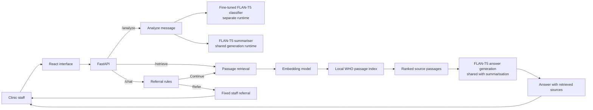

# Diabetes Care Support Assistant

**Course:** AIMLCZG549 - API-Driven Cloud-Native Solutions
**Assignment:** Assignment II
**Group:** 49
**Institution:** BITS Pilani, Work Integrated Learning Programmes
**Source repository:** [GitHub](https://github.com/sanjaykumarpushadapu/Assignment-APIDrivenCloudNativeSolutions-AIMLCZG549)

This report presents the design, implementation, and evaluation of an interactive diabetes-care support application. It is organised around the four assessed areas in Assignment II: API-based AI application, fine-tuning, retrieval-augmented generation, and situated learning in a workplace analogue.

## Team Contribution and Work Allocation

Each member contributed 25% of the group work. The qualitative contributions below are organised around the four assessed parts in the assignment brief; the percentage records the group’s agreed equal share of the overall work.

| Sl. No. | BITS ID | Name | Contribution of team member  | Percentage Contribution (Out of 100) |
|---:|---|---|---|---:|
| 1 | 2025ae05391 | Bhuvnesh Mishra | **Part I – API-Based AI Application:** built the FastAPI and React application and connected classification, summarisation, and question answering in the staff workflow. | 25% |
| 2 | 2025ae05828 | Chezrla Raga Suma | **Part II – Fine-Tuning:** prepared and reviewed classification examples and labels, fine-tuned the FLAN-T5 classifier, and evaluated the base and tuned checkpoints. | 25% |
| 3 | 2025ae05425 | Sathish Krishnan V | **Part III – RAG:** selected and checked the WHO source, prepared the local knowledge passages, and implemented retrieval for question answering. | 25% |
| 4 | 2025ae05898 | Pushadapu Sanjay Kumar | **Part IV – Situated Learning:** defined the diabetes clinic support-desk workflow, selected representative synthetic cases, and analysed the evaluation against workplace needs. | 25% |
| **Total** |  |  |  | **100%** |

## Project and Platform Details

This project is an interactive, staff-facing AI application for a diabetes clinic support desk. It combines three natural language processing tasks to help staff route incoming messages, prepare handoff summaries, and answer general diabetes questions from a selected source. The application has a React and TypeScript interface with a FastAPI backend.

The three tasks share one workflow objective: help support staff understand and respond to routine enquiries. Classification and summarisation operate on synthetic support messages. The knowledge assistant answers general questions from a curated World Health Organization (WHO) diabetes FAQ and returns the passages used. Clinic-specific procedures and personal treatment decisions are referred to staff because they are outside the indexed source.

| Task | Input and output | Model used by the application |
|---|---|---|
| Request classification | A support message is assigned one primary clinic-support category | Fine-tuned `google/flan-t5-base` checkpoint, `clinic-support` |
| Message summarisation | A support message is condensed into a staff handoff summary | Pinned `google/flan-t5-base` |
| Retrieval-augmented question answering | A question is answered from retrieved WHO passages, with the passages returned as sources | `google/flan-t5-base` answer model and `sentence-transformers/all-MiniLM-L6-v2` retriever |

The base FLAN-T5 model revision is `7bcac572ce56db69c1ea7c8af255c5d7c9672fc2`. The classifier has its own runtime. Summarisation and RAG answer generation share one FLAN-T5 runtime and configuration; retrieval uses a separately configured embedding model. The API exposes `/health`, `/metadata`, `/analyze`, `/retrieve`, and `/chat`.

## Architecture Overview

The React and TypeScript interface sends support messages and questions to FastAPI. The diagram shows how the three tasks connect to the local models and WHO passages. The classifier has a separate runtime; summarisation and answer generation use the same FLAN-T5 runtime. Referral rules can return a fixed staff response before generation.

## I. API-Based AI Application

### Domain and workflow

The selected category is natural language processing in the healthcare-support domain. The workplace is a fictional diabetes clinic support desk, used as an industry analogue. In the proposed workflow, staff read incoming messages, route requests, prepare handoffs, and consult education material when responding to general questions. Staff review the assistant's outputs before using them.

For example, one message may request an appointment change and help finding an education leaflet. The classifier selects the primary queue; the summary preserves the relevant requests for a staff handoff. A separate question about general diabetes information can be submitted to the knowledge assistant, which displays its answer and source passages.

### Application and API

The React interface collects support messages and knowledge questions. FastAPI validates the requests and calls the configured model and retrieval components. `POST /analyze` returns the support-message classification and summary. `POST /retrieve` returns ranked source passages so retrieval can be inspected. `POST /chat` returns a source-grounded answer or a staff-referral response. `/metadata` reports component readiness and model or index versions.

The classifier uses the Hugging Face Transformers sequence-to-sequence interface. The application loads the tokenizer and model from the configured Hub model or local checkpoint. Classification uses a fixed task instruction and returns the generated label only when it matches one of the five supported categories: appointment support, education resource request, portal technical support, records/insurance administration, or clinical staff referral.

### Observed application examples

Figure 2 shows the interactive support-message workflow in the React application. It uses a synthetic request and displays the request category and handoff summary. The later examples in Section IV show how the application supports the workplace analogue.

### API demonstration

The Swagger UI request below demonstrates `POST /analyze`. The response shows the predicted category and generated handoff summary for a synthetic rescheduling request. In this run, the summary retained that the new booking had not yet been confirmed.

**Figure 1. Swagger request and response for `POST /analyze`.**

**Figure 2. Support-message analysis in the interactive application.**

## II. Fine-Tuning

### Dataset and method

The classifier uses five support categories. The dataset contains 280 synthetic training messages, 60 validation messages, and 60 held-out test messages, with 56 training and 12 validation/test examples per category. The messages are AI-drafted and reviewed for the classification task. Scenario-family identifiers were used when preparing the partitions, and the exact-duplicate review found no repeated messages across the partitions.

The classifier received full fine-tuning from the pinned `google/flan-t5-base` checkpoint. AdamW updated the model parameters for one epoch, using batch size 1, gradient accumulation of 8, learning rate `5e-5`, and seed 42. The run completed 35 optimizer steps. The selected checkpoint was saved locally and used by the application.

### Validation and held-out results

The fine-tuned checkpoint achieved 98.33% accuracy and 98.33% macro-F1 on the 60-example validation set, with no invalid category outputs. The original model scored 71.67% accuracy and 71.81% macro-F1 on the same validation set. The validation set was used during model development, so these figures are validation results.

The base and fine-tuned models were then evaluated on the same 60-example held-out test set, with the same application prompt and greedy decoding. The test set was not used for training or model selection.

| Measure | Base model | Fine-tuned classifier |
|---|---:|---:|
| Accuracy | 86.67% (52/60) | 95.00% (57/60) |
| Macro precision | 95.00% | 95.39% |
| Macro recall | 86.67% | 95.00% |
| Macro-F1 | 88.74% | 94.74% |
| Invalid category outputs | 4/60 | 0/60 |

The fine-tuned model's three errors involved authorised-contact paperwork, preferred language for clinic letters, and insurance coverage for an appointment fee. The examples are synthetic and the test set contains 60 messages; the results describe this dataset and are not a measure of real clinic performance.

**Figure 3. Fine-tuning method and held-out classifier results.**

### Summary quality check

The configured base summariser was evaluated on 20 reviewed synthetic message/summary cases, each with an essential-fact checklist. Its mean ROUGE-L F1 was 0.3912. Review found all 20 summaries supported by the input and no unsupported facts added; 10 of 20 retained every essential fact. This evaluation shows that summaries can omit details, so staff should check each handoff against the original message.

## III. Retrieval-Augmented Generation

### Source and retrieval

The indexed corpus is prepared from one public source: the WHO page *Diabetes: Questions and Answers* (https://www.who.int/news-room/questions-and-answers/item/diabetes), dated 1 September 2026 in the local source manifest. The corpus contains eight curated passages covering diabetes basics, common symptoms, prevention, and high-level education and self-management support. Each passage carries its source title, section, URL, and chunk ID.

The retriever uses `sentence-transformers/all-MiniLM-L6-v2`, pinned to revision `1110a243fdf4706b3f48f1d95db1a4f5529b4d41`, and returns the three highest-ranked passages. The answer model receives the question and retrieved passages. `/chat` includes the retrieved passages with a generated answer; requests identified by referral rules as personal clinical advice, urgent symptoms, or clinic-specific processes receive a fixed staff referral.

### API demonstration

Swagger UI confirms that `/retrieve` returns ranked WHO passages and that `/chat` returns a staff referral for an individual medication question.

**Figure 4. Swagger response from `POST /retrieve` with ranked WHO passages.**

**Figure 5. Swagger response from `POST /chat` for a medication question.**

**Figure 6. General-information answer and retrieved source sections in the web interface.**

### Evaluation results

The initial evaluation used 30 reviewed cases: 20 answerable from the indexed source and 10 expected to be referred to staff. It measured the application before the referral rules were expanded. The baseline results below describe that earlier version, not the current implementation. The displayed final test figures must come from a fresh, independent review of the frozen implementation; development diagnostic results are not reported as final performance.

| Measure | Result |
|---|---:|
| Retrieval hit@3 on answerable cases | 20/20 (100%) |
| Expected answer/referral decisions matched | 23/30 (76.7%) |
| Expected staff referrals detected | 4/10 (40%) |
| Answerable questions incorrectly abstained | 1/20 (5%) |
| Answerable cases producing an answer judged supported by its source | 18/20 (90%) |
| Answerable cases with a correct source citation | 18/20 (90%) |
| Answerable cases with a correct and complete response | 16/20 (80%) |

The baseline missed six of ten expected referrals, including missed-dose advice, individual glucose readings, clinic appointment and education-session logistics, medication interaction advice, and a severe low-blood-sugar question. One answerable question was incorrectly abstained on; one generated answer did not support its answer key; and four answers were judged incomplete or incorrect. These are results from the earlier version.

The current implementation includes routing rules for personal-care, clinic-process, and urgent-symptom questions. Development diagnostic cases informed those changes and are excluded from performance claims. Regression checks cover selected phrasings; an independent evaluation is required to establish answer support and referral quality for the current version.

## IV. Situated Learning - Workplace Application

### Anchor - Identify a workplace problem

The workplace analogue is a diabetes clinic support desk. Staff receive messages about appointments, education resources, the patient portal, records, and clinical questions. The current workflow requires staff to read each message, determine where it should go, prepare a handoff, and search education material when answering general questions. This creates repeated reading and lookup work, while clinic-specific requests still need the appropriate team or approved procedure. The application supports message organisation and source lookup in this workflow. The evaluation uses synthetic messages and public education material.

### Apply - Adapt the AI solution

The support-message interface accepts a message and displays its primary category and handoff summary. The knowledge assistant accepts a question, displays an answer, and lists the retrieved WHO passages. In the representative appointment case, the system classified the request as `appointment_support`. The captured output kept the work conflict, requested Friday time, availability check, and the fact that a new booking was still unconfirmed. In the separate 20-case summary evaluation, 10 outputs retained every essential fact, so staff review each handoff against the original message. Appointment changes remain with clinic staff.

For a general symptoms question, `/chat` returned an answer based on WHO01-003, “Common symptoms.” Figure 6 in Part III shows the answer and retrieved source sections. For “Should I change my diabetes medication?”, the interface displayed the fixed staff-referral response and no sources, shown in Figure 7. Figure 2 in Part I shows the request-analysis flow. Together, these examples demonstrate the fine-tuned classifier, summariser, retrieval, answer generation, and referral workflow.

**Figure 7. Medication question referred to clinic staff in the web interface.**

### Analyse - Evaluate workplace relevance

The classifier's held-out test result was 95.00% accuracy and 94.74% macro-F1 on synthetic messages. For summarisation, 10/20 outputs retained all required facts. In the pre-fix RAG evaluation, a relevant passage was retrieved in all 20 answerable cases, while 4/10 referral cases were correctly referred. Together, these results show that classification performed best on the evaluated examples; summarisation and answer/referral quality still require staff review. The retrieval score alone did not ensure that a generated answer was supported.

The evaluation assessed answer quality and referral outcomes on fixed case sets. No staff-handling times were collected, so efficiency gains are not quantified. The application demonstrates message routing and source inspection; staff continue to complete appointment, portal, and records transactions through clinic workflows.

### Reflect - Deployment constraints and improvement

The application uses synthetic support messages and public education material. Before any use with real health information, the clinic would need to determine permitted data use, access and retention controls, and applicable privacy and security requirements. The regulatory requirements depend on the organisation and jurisdiction. The model and retrieval components run as a locally configured application. Operating costs would vary with hosting, model storage, inference capacity, monitoring, and maintenance. Clinic-specific appointment, portal, and leaflet instructions would need to come from approved clinic sources before the assistant could answer those questions.

The single most important improvement before workplace deployment is an independent, domain-expert-reviewed evaluation of the complete staff workflow on approved representative cases, focused on summary fact preservation, answer support, and correct referral. This is justified by the observed incomplete summaries and missed referrals in the baseline evaluation. Integration with clinic scheduling, portal, and records systems would require approved interfaces and workflow validation.

## Conclusion

The application brings request classification, handoff summarisation, and document-grounded question answering into one staff workflow. Held-out results show strong classification on the synthetic test set, while the summary and baseline RAG evaluations identify where staff review remains necessary.

## Demonstration Video

**Demonstration video:** Google Drive link to be added after the required project demonstration is uploaded.
