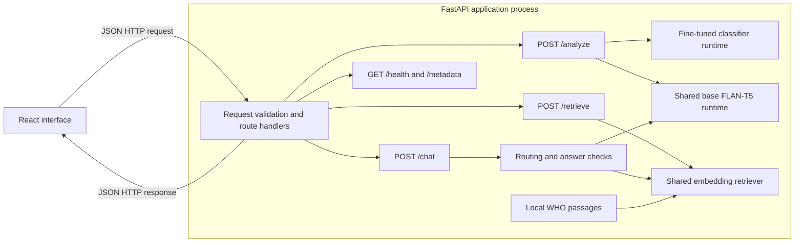
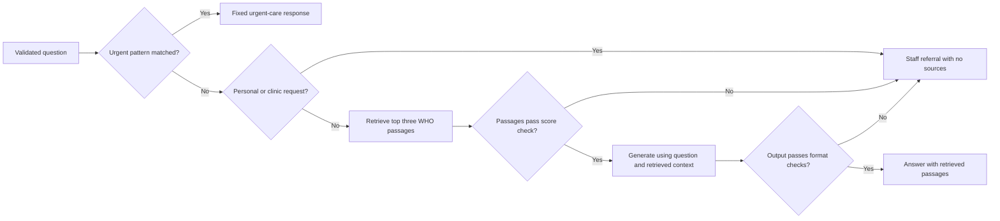

# Group Details

**Course:** AIMLCZG549 - API-Driven Cloud-Native Solutions  
**Assignment:** Assignment II
**Institution:** BITS Pilani, Work Integrated Learning Programmes  
**Group No.:** 49
**Source repository:** [GitHub](https://github.com/sanjaykumarpushadapu/Assignment-APIDrivenCloudNativeSolutions-AIMLCZG549)

## Group Member Names with Contribution

We shared the work across the project and report an equal contribution of 25% for each of the four members. The descriptions below identify each member's main tasks; they are not an assignment of one whole assessment part to one person.

|   Sl. No. | BITS ID     | Name                   | Contribution of team member (Qualitative)                                                                                                        | Percentage Contribution (Out of 100) Quantitative |
| --------: | ----------- | ---------------------- | ------------------------------------------------------------------------------------------------------------------------------------------------ | ------------------------------------------------: |
|         1 | 2025ae05391 | Bhuvnesh Mishra        | Developed the React interface and FastAPI routes; integrated classification, handoff summaries, and RAG question answering in one workflow.      |                                               25% |
|         2 | 2025ae05828 | Chezrla Raga Suma      | Prepared and reviewed classification messages and labels; fine-tuned the FLAN-T5 classifier and evaluated it against the base model.             |                                               25% |
|         3 | 2025ae05425 | Sathish Krishnan V     | Selected and checked the WHO source, prepared the local knowledge passages, and implemented the embedding retrieval used for question answering. |                                               25% |
|         4 | 2025ae05898 | Pushadapu Sanjay Kumar | Defined the clinic-support workflow, prepared representative synthetic cases, and analysed the results against workplace needs.                  |                                               25% |
| **Total** |             |                        |                                                                                                                                                  |                                          **100%** |

# Diabetes Care Support Assistant

> **MASTER REPORT WORKING NOTE — REMOVE FROM STUDENT SUBMISSION COPIES.** This file keeps the shared report and all four student-specific versions of Part IV together. When preparing each student's upload, copy the same Sections I–III and include only that student's Part IV section below. Leave the other three Part IV sections out of that student's copy; keep the rest of the report identical.

Our team built an interactive application for a diabetes-clinic support desk. This report follows the four parts of Assignment II: the API-based application, fine-tuning, retrieval-augmented generation, and workplace application.

## Project and Platform Details

**Selected application category: Natural Language Processing (NLP).** We chose healthcare support for a diabetes-clinic desk. Staff can enter a message or ask a question; the app returns a category, a handoff summary, or an answer with its source passages. We connected three NLP tasks in one React and FastAPI workflow: text classification, text summarisation, and question answering using retrieval-augmented generation (RAG).

| NLP task                     | Natural-language input and output                                                | Method/model                                                              |
| ---------------------------- | -------------------------------------------------------------------------------- | ------------------------------------------------------------------------- |
| Text classification          | Support message → one of five clinic-support labels                              | Supervised fine-tuning of `google/flan-t5-base`                           |
| Text summarisation           | Support message → staff handoff summary                                          | `google/flan-t5-base` text generation                                     |
| Question answering using RAG | Staff question → answer grounded in relevant WHO passages, returned with sources | `sentence-transformers/all-MiniLM-L6-v2` retrieval and FLAN-T5 generation |

We pinned the FLAN-T5 base model to revision `7bcac572ce56db69c1ea7c8af255c5d7c9672fc2`. The classifier runs separately; summarisation and answer generation share a FLAN-T5 runtime. Retrieval uses its configured embedding model. Our API exposes `/health`, `/metadata`, `/analyze`, `/retrieve`, and `/chat`.

## Architecture Overview

In our app, React sends JSON requests to FastAPI and displays the returned JSON. The model and retrieval components run within the FastAPI application. `/analyze` returns a category and handoff summary, `/retrieve` returns ranked WHO passages, and `/chat` checks for urgent or personal-care questions before it generates a source-grounded answer. The classifier has its own fine-tuned runtime; summarisation and answer generation share the base FLAN-T5 runtime.

The arrows within FastAPI show Python component calls and data dependencies. `/analyze` combines the classifier output and summary; `/retrieve` returns ranked passages; `/chat` returns an answer with passages or a fixed referral response. The following flow expands the chat checks implemented by the knowledge answerer.

The score check requires at least one passage and a top similarity score at or above the configured threshold. The output check rejects empty text, an ABSTAIN prefix, and citation-only text. These checks handle the listed conditions; they do not establish that every generated statement is supported. Answer support is assessed separately against the retrieved text.

## I. API-Based AI Application

### Domain and workflow

We modelled a diabetes-clinic support desk. Staff read incoming messages, route requests, prepare handoffs, and consult education material for general questions. In the app, they review the assistant's output before using it.

For example, a message can ask to change an appointment and find an education leaflet. `/analyze` returns a category and handoff summary; we evaluate the summaries in Part II. Staff can also ask a general diabetes question in the knowledge assistant and inspect its answer and source passages.

### Application and API

The React interface collects support messages and knowledge questions. FastAPI validates each request and calls the configured models or retriever. `POST /analyze` returns a category and summary, `POST /retrieve` returns ranked passages, and `POST /chat` returns an answer, staff referral, or urgent-care response. `/metadata` shows which components and model or index versions are loaded.

The classifier uses the Hugging Face Transformers sequence-to-sequence interface. The application loads the tokenizer and model from the configured Hub model or local checkpoint. Classification uses a fixed task instruction and returns the generated label only when it matches one of the five supported categories: appointment support, education resource request, portal technical support, records/insurance administration, or clinical staff referral.

### API demonstration

The Swagger UI request below demonstrates `POST /analyze` with a synthetic rescheduling request. The React screenshot shows the category and handoff-summary field in the interactive application.

**Figure 1. Swagger request and response for `POST /analyze`.**

**Figure 2. Live support-message analysis in the interactive application.**

Functional validation covered support-message analysis, question answering with displayed sources, and an urgent-care response. The frontend production build succeeded.

## II. Fine-Tuning

### Dataset and method

The classifier uses five support categories. The dataset contains 280 synthetic training messages, 60 validation messages, and 60 held-out test messages, with 56 training and 12 validation/test examples per category. The messages are AI-drafted and reviewed for the classification task. Scenario-family identifiers were used when preparing the partitions, and the exact-duplicate review found no repeated messages across the partitions.

We started with FLAN-T5 because it can follow instructions and generate text. The app needs it to return one of five clinic-support labels, including a referral label for personal clinical questions. A general model does not know our label guide, so we fine-tuned it using an instruction and support message as input and the reviewed category as the target. This taught the model to map our example messages to the clinic's labels.

We fully fine-tuned the pinned `google/flan-t5-base` checkpoint. For this run, AdamW updated the model for one epoch with batch size 1, gradient accumulation 8, learning rate `5e-5`, and seed 42; it completed 35 optimizer steps. We saved the selected checkpoint locally and used it in the evaluated app. To reproduce the run, install the inference dependencies and, from `Assignment-2`, run `uv run --extra inference python scripts/train_classifier.py --epochs 1 --output-dir artifacts/models/clinic-support-candidate`. Set `CLASSIFIER_MODEL_NAME=./artifacts/models/clinic-support-candidate` in `.env` and restart the API to load it. The training script uses the tracked training and validation data, not the held-out test set. Evaluate a new checkpoint separately before comparing it with the scores below. The comparison measures our task-specific fine-tuning against the prompted base model.

### Validation and held-out results

The fine-tuned checkpoint achieved 98.33% accuracy and 98.33% macro-F1 on the 60-example validation set. The validation set was used during model development, so these figures are validation results. The held-out test comparison below is the reported base-versus-tuned comparison.

The base and fine-tuned models were then evaluated on the same 60-example held-out test set, with the same application prompt and greedy decoding. The test set was not used for training or model selection.

| Measure                  |     Base model | Fine-tuned classifier |
| ------------------------ | -------------: | --------------------: |
| Accuracy                 | 86.67% (52/60) |        95.00% (57/60) |
| Macro precision          |         95.00% |                95.39% |
| Macro recall             |         86.67% |                95.00% |
| Macro-F1                 |         88.74% |                94.74% |
| Invalid category outputs |           4/60 |                  0/60 |

The examples and test set are synthetic; these scores summarise classification on the 60-message set.

**Figure 3. Fine-tuning method and held-out classifier results.**

### Summary quality check

The configured base summariser was evaluated on 20 reviewed synthetic message/summary cases with essential-fact checklists. Mean ROUGE-L F1 was 0.3912. All 20 outputs were supported by their input messages, and 10 of 20 retained every checklist fact.

## III. Retrieval-Augmented Generation

### Source and retrieval

We prepared the indexed corpus from one public source: WHO's _Diabetes: Questions and Answers_ (https://www.who.int/news-room/questions-and-answers/item/diabetes), dated 1 September 2026 in our local source manifest. It contains eight curated passages about diabetes basics, common symptoms, prevention, and general education and self-management support. We kept the title, section, URL, and chunk ID with each passage.

We pinned the retriever, `sentence-transformers/all-MiniLM-L6-v2`, to revision `1110a243fdf4706b3f48f1d95db1a4f5529b4d41`. It embeds the question and WHO passages, ranks them by cosine similarity, and returns the top three. FLAN-T5 receives the question and those passages, then `/chat` returns its answer with the sources for staff to check. We retrieve the passages first so the answer can be reviewed against the selected source; we can also update the source material without fine-tuning the answer model. Personal-care and clinic-process questions get a staff referral, and selected urgent phrases get a fixed urgent-care response. Other questions go through the retrieval-score and output-format checks shown in the architecture flow.

### API demonstration

Swagger UI confirms that `/retrieve` returns ranked WHO passages and that `/chat` returns a staff referral for an individual medication question.

**Figure 4. Swagger response from `POST /retrieve` with ranked WHO passages.**

**Figure 5. Swagger response from `POST /chat` for a medication question.**

**Figure 6. General-information answer and retrieved source sections in the web interface.**

### Evaluation results

We reviewed 30 RAG cases: 20 questions answerable from the indexed source and 10 expected referrals. We checked retrieval relevance, answer support, citations, completeness, and answer/referral decisions against the WHO passages and answer key. These results are for the initial routing-rule configuration, before we refined the routing rules.

| Measure                                                             |        Result |
| ------------------------------------------------------------------- | ------------: |
| Retrieval hit@3 on answerable cases                                 |  20/20 (100%) |
| Expected answer/referral decisions matched                          | 23/30 (76.7%) |
| Expected staff referrals detected                                   |    4/10 (40%) |
| Answerable questions incorrectly abstained                          |     1/20 (5%) |
| Answerable cases producing an answer judged supported by its source |   18/20 (90%) |
| Answerable cases with a correct source citation                     |   18/20 (90%) |
| Answerable cases with a correct and complete response               |   16/20 (80%) |

Retrieval returned a relevant passage for all 20 answerable questions. Reviewers found 18 answers supported and 16 both correct and complete. The system made the expected answer or referral decision in 23 of 30 cases. These are baseline results; we did not rerun this evaluation after refining the routing rules.

### Current routing regression check

The current application was also checked on 15 existing development cases: eight answerable questions and seven expected referrals. Retrieval found an expected source in all eight answerable cases. The answer/referral decision matched in 14/15 cases (93.3%), and all seven expected referrals were returned. One answerable question was abstained on (1/8). These cases had informed routing development, so this check measures known-case behaviour; the preceding 30-case baseline remains the recorded evaluation of its earlier configuration. Answer support and completeness were not rescored in this regression run.

## IV. Situated Learning – Workplace Application

The workplace example is a diabetes-clinic support desk, used as an industry analogue. Its staff review incoming appointment, education, portal, records, and clinical-care messages; prepare handoffs; and consult public education material when answering general questions. Repeated reading and switching between message and reference material can add work and omit details from handoffs. The application brings first-pass classification, summaries, and source passages into one staff workflow. It uses synthetic messages and public WHO material.

The four student-specific versions below apply the shared system to different views of the same clinic workflow. Each follows the assessed Anchor, Apply, Analyse, and Reflect areas. Their different workplace focuses do not assign exclusive ownership of an assessment part; the equal contribution shares above apply across the project.

### Part IV — Bhuvnesh Mishra: Staff Workflow Integration

#### Anchor — Identify a Workplace Problem

Clinic support staff need a single intake workflow for messages that may involve scheduling, education material, portal access, records, or clinical questions. Without a shared intake screen, staff must identify the request, prepare a handoff, and locate information in separate steps. A shared interface is expected to reduce switching between those steps and make the next action easier to see. The diabetes-clinic support desk is a synthetic industry analogue for this workflow.

#### Apply — Adapt the AI Solution to the Workplace

The React staff interface sends support messages and questions to FastAPI. `POST /analyze` returns a category and handoff summary; `POST /retrieve` returns ranked WHO passages; and `POST /chat` returns a source-backed answer or routes selected questions to a staff referral or urgent-care response. Figures 1 and 2 show the request-analysis flow, while Figures 6 and 7 show a source-backed answer and a medication-question referral. The Swagger examples in Figures 1, 4, and 5 document successful API requests.

#### Analyse — Evaluate Workplace Relevance

The API examples returned HTTP 200 for `/metadata`, `/analyze`, `/retrieve`, and `/chat` during the recorded demonstration. In the reviewed outputs, the classifier produced 57 correct categories out of 60; the summary review found every output supported by its input, but all checklist facts were retained in only 10 of 20 cases. The routes connect the tasks in one interface, while the evaluation shows why staff must review the category and summary before using them.

#### Reflect — Deployment Constraints and Improvements

The demonstration uses synthetic messages and public WHO information. A workplace deployment would need privacy and security controls for access, transfer, storage, and retention; review of applicable health-data regulation; approved infrastructure and storage; cost planning; and integration with existing staff systems. The most important improvement for this application perspective is a clinic-approved, access-controlled validation pilot using deidentified representative messages before any connection to scheduling, portal, or records systems. This would check both the API workflow and its outputs with staff while establishing data-handling controls.

### Part IV — Chezrla Raga Suma: Request Routing

#### Anchor — Identify a Workplace Problem

At a diabetes-clinic support desk, staff manually read messages about several operational categories as well as personal clinical questions before routing them. Inconsistent first-pass sorting can send a request to the wrong team or require repeat review. A consistent category suggestion can support initial routing while staff retain responsibility for checking the message. This example uses the same synthetic clinic workflow and does not use patient records.

#### Apply — Adapt the AI Solution to the Workplace

The classifier was fine-tuned on reviewed examples for five clinic-support labels: appointment support, education resource request, portal technical support, records/insurance administration, and clinical staff referral. A representative rescheduling message is classified as `appointment_support` in Figure 2. Figure 3 documents the fine-tuning method and compares the prompted base model with the tuned classifier.

#### Analyse — Evaluate Workplace Relevance

On the held-out 60-message test set, the fine-tuned classifier achieved 95.00% accuracy and 94.74% macro-F1, compared with 86.67% accuracy and 88.74% macro-F1 for the base model. The tuned model still misclassified three messages, so the predicted category is a routing aid that staff should check against the original message. The evaluation uses synthetic messages and measures category prediction, not clinic throughput or staff time.

#### Reflect — Deployment Constraints and Improvements

Using identifiable messages would require privacy and security controls for access, transfer, storage, and retention, plus review of applicable health-data regulations. Model hosting also requires approved computing and storage, cost planning, and integration with the clinic's message channels. The most important improvement for classification is to validate the label guide and model with a larger, clinic-reviewed set of deidentified examples that reflects the wording and category mix staff actually receive. This addresses the three observed errors before the classifier is used to route live requests.

### Part IV — Sathish Krishnan V: Source-Based Staff Answers

#### Anchor — Identify a Workplace Problem

Clinic staff may need to answer general diabetes-education questions using a reliable reference while directing personal-care questions to the clinical team. Finding the relevant passage manually can slow the response, while an unsupported answer may mislead. A retrieved passage shown with its source is expected to make general information easier for staff to locate and verify. This industry analogue uses public WHO material and synthetic questions.

#### Apply — Adapt the AI Solution to the Workplace

The local knowledge set contains eight curated passages from WHO's _Diabetes: Questions and Answers_. `/retrieve` ranks passages and returns the top three with section and source details. `/chat` uses retrieved text to answer a general symptoms question and includes its passages, as shown in Figure 6; a medication-change question receives a staff referral, as shown in Figure 7. This lets staff inspect the supporting text before using an answer.

#### Analyse — Evaluate Workplace Relevance

In the recorded 30-case baseline, retrieval found a relevant passage in all 20 answerable cases. Reviewers judged 18 answers supported by the source and 16 both correct and complete; four of the 20 answerable outputs were incomplete or incorrect. These results show that source retrieval worked on the reviewed questions, while answer completeness still needs staff review. The later 15-case check used development cases and is reported separately as a regression check, not as an independent evaluation.

#### Reflect — Deployment Constraints and Improvements

The current corpus contains public WHO information rather than clinic-specific guidance. Any workplace use would need a reviewed and maintained source set, privacy and security controls for any submitted patient information, and review of applicable health-data regulation. Hosting the embedding model and index requires approved infrastructure, storage, and cost planning; integration with clinic systems would also need governance. The most important improvement for this RAG component is a clinic-approved, versioned knowledge collection with a staff-reviewed question set to check retrieval, answer support, completeness, and referral behaviour before it is used in the workflow.

### Part IV — Pushadapu Sanjay Kumar: Handoffs and Workflow Review

#### Anchor — Identify a Workplace Problem

The clinic support desk receives compound requests that may combine an appointment change with an education-resource question, as well as questions that require clinical staff rather than general education. Staff need a handoff that preserves the request details and a clear way to distinguish general questions from personal-care questions. A summary that retains both requests is expected to help staff prepare a complete handoff without losing secondary details. The examples below are synthetic and use a diabetes-clinic industry analogue.

#### Apply — Adapt the AI Solution to the Workplace

The representative message asking to move a diabetes-education appointment and locate a preparation leaflet exercises classification and handoff summarisation together. A general symptoms question exercises WHO-grounded answer generation, while “Should I change my diabetes medication?” exercises the staff-referral path. The urgent phrase example exercises the fixed urgent-care response. Figures 2, 6, and 7 show these outputs in the application.

#### Analyse — Evaluate Workplace Relevance

The 20-case summary review found all summaries supported by their input, but only 10 retained every checklist fact; staff must compare appointment details and secondary requests with the original. The classifier got 57 of 60 held-out cases correct. In the RAG baseline, 16 of 20 answerable questions received a response judged both correct and complete. Together, these results support using the workflow as a staff aid with source and input review, but they do not demonstrate time savings or performance under clinic workload.

#### Reflect — Deployment Constraints and Improvements

Identifiable support messages would require safeguards for privacy, access, transfer, storage, and retention, and review against applicable health-data regulation. The models and index need approved infrastructure and storage, a cost plan, and approved integration with scheduling, portal, and records systems. The single most important improvement is a clinic-approved, staff-supervised validation pilot with deidentified representative cases, measuring handoff fact retention and safe referral decisions before any live system integration. This tests whether the combined workflow addresses the staff problem while controlling how its outputs are used.

**Figure 7. Medication question referred to clinic staff in the web interface.**

## Conclusion

We built a React and FastAPI application that brings classification, handoff summaries, and RAG question answering into one diabetes-clinic support workflow. We fully fine-tuned the classifier and evaluated it against the prompted base model on held-out messages. We also reviewed summary fact retention and measured retrieval, answer support, and referral decisions for the recorded RAG baseline. The screenshots show the application and example outputs. Our results show how the three tasks can support staff review in this workflow.

## Demonstration Video

**Demonstration video:** Google Drive link to be added after the required project demonstration is uploaded.
