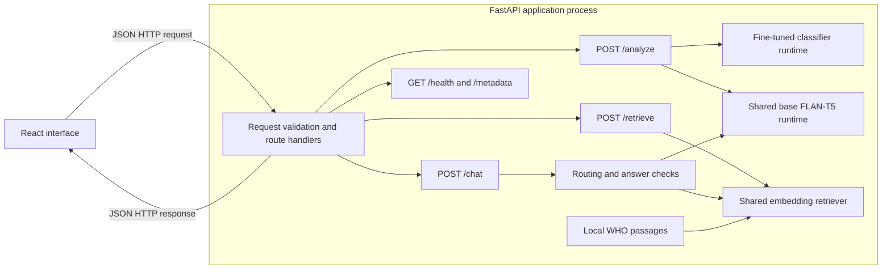
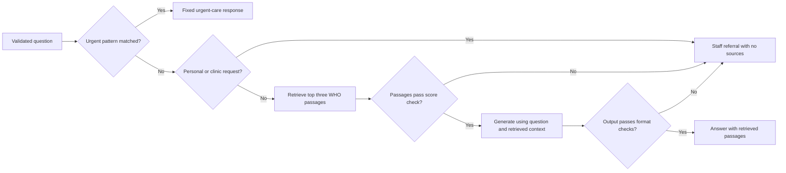
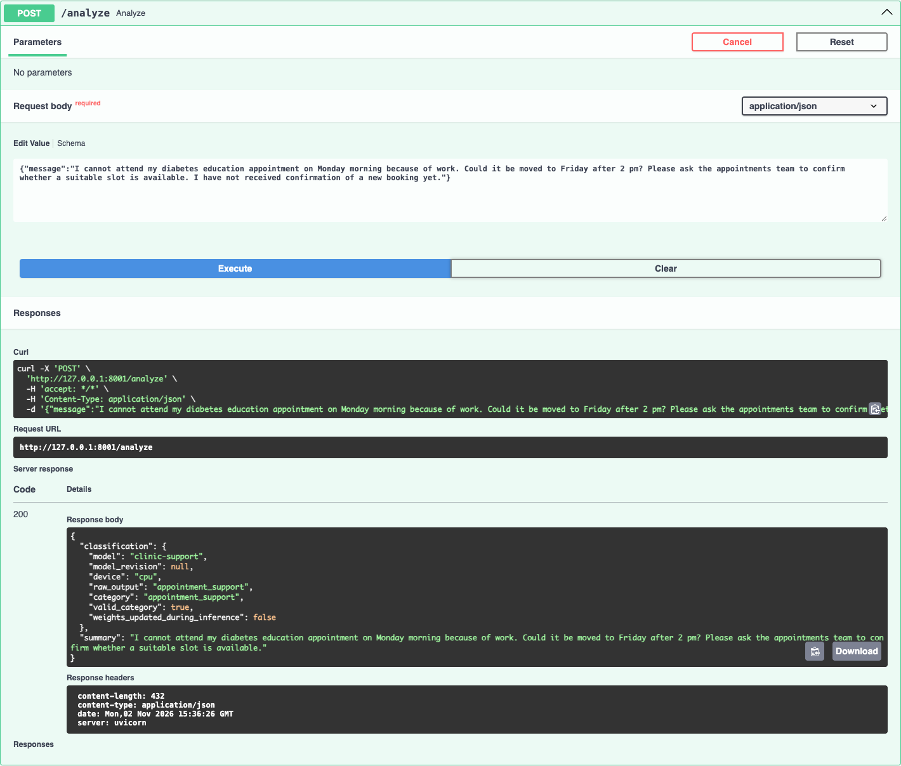
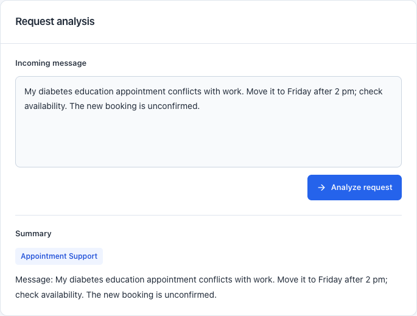
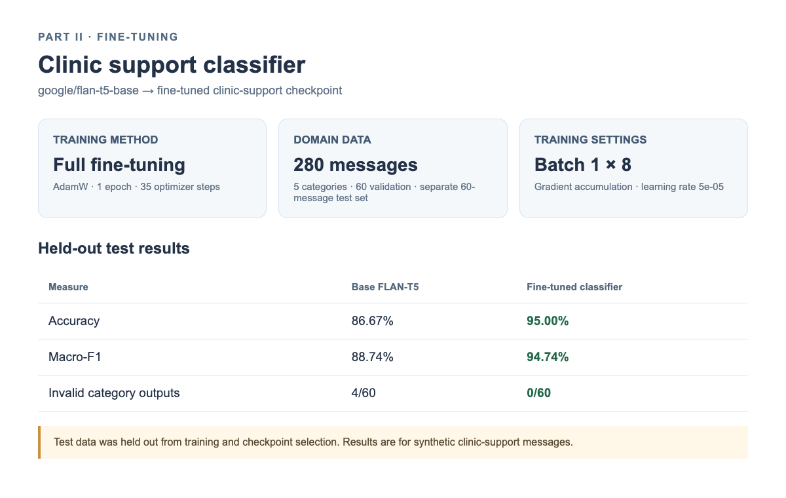
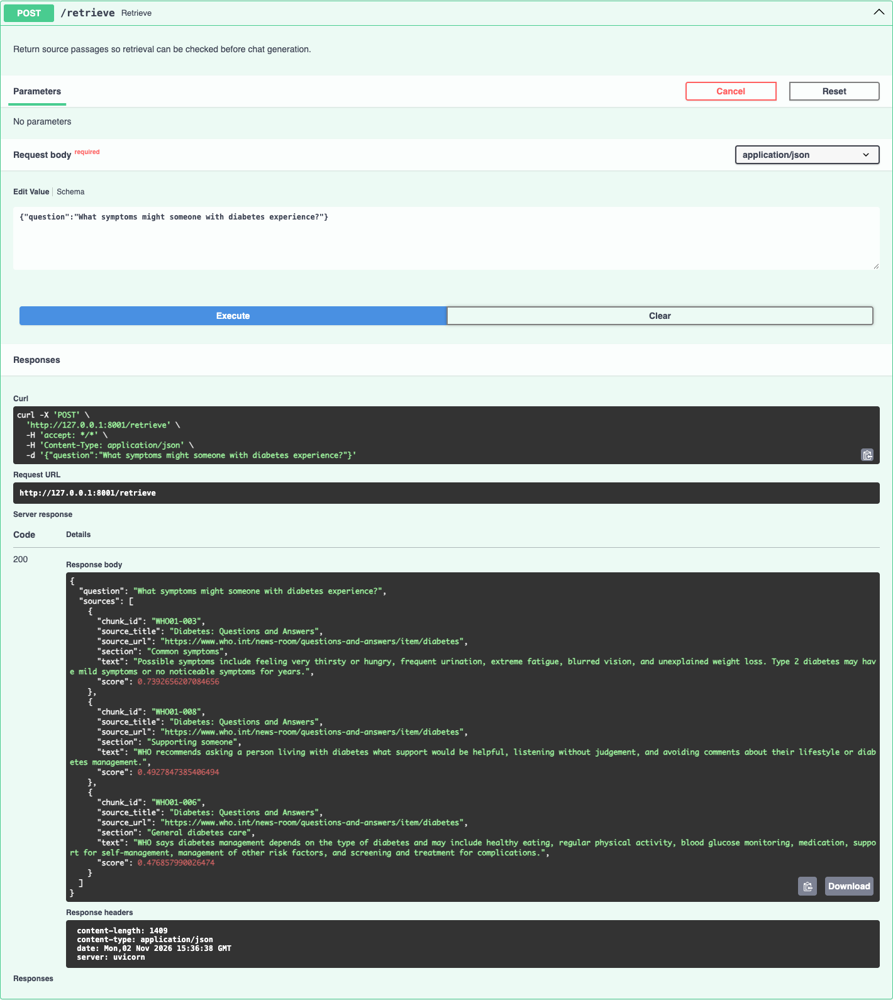
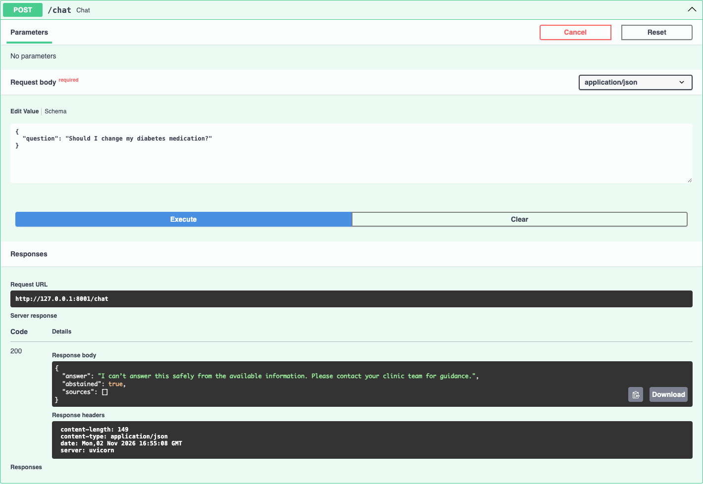
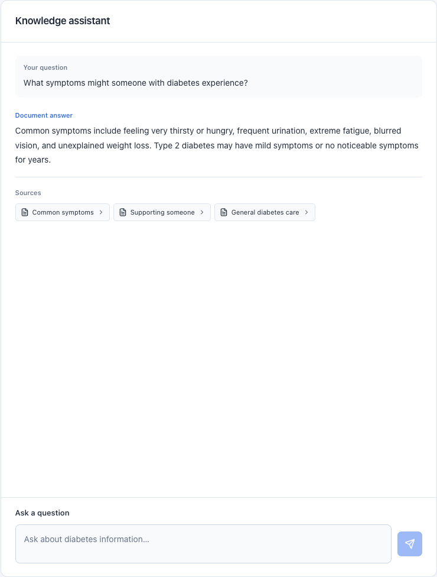
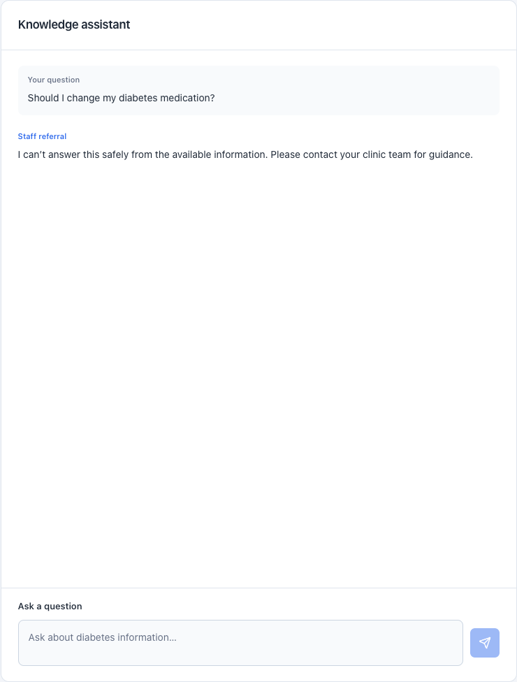

# Diabetes Care Support Assistant

**Course:** AIMLCZG549 - API-Driven Cloud-Native Solutions
**Assignment:** Assignment II
**Group:** 49
**Institution:** BITS Pilani, Work Integrated Learning Programmes
**Source repository:** [GitHub](https://github.com/sanjaykumarpushadapu/Assignment-APIDrivenCloudNativeSolutions-AIMLCZG549)

This report presents the design, implementation, and evaluation of an interactive diabetes-care support application. It addresses the four assessed areas in Assignment II: API-based AI application, fine-tuning, retrieval-augmented generation, and situated learning.

## Team Contribution and Work Allocation

The group agreed on equal contribution shares of 25% each. The qualitative descriptions identify each member’s primary responsibility across the assessed parts; they do not indicate unequal effort.

| Sl. No. | BITS ID | Name | Contribution of team member  | Percentage Contribution (Out of 100) |
|---:|---|---|---|---:|
| 1 | 2025ae05391 | Bhuvnesh Mishra | **Part I – API-Based AI Application:** built the FastAPI and React application and integrated classification, summarisation, and question answering in the staff workflow. | 25% |
| 2 | 2025ae05828 | Chezrla Raga Suma | **Part II – Fine-Tuning:** prepared and reviewed classification examples and labels, fine-tuned the FLAN-T5 classifier, and evaluated the base and tuned checkpoints. | 25% |
| 3 | 2025ae05425 | Sathish Krishnan V | **Part III – RAG:** selected and checked the WHO source, prepared the local knowledge passages, and implemented retrieval for question answering. | 25% |
| 4 | 2025ae05898 | Pushadapu Sanjay Kumar | **Part IV – Situated Learning:** defined the diabetes clinic support-desk workflow, selected representative synthetic cases, and analysed the evaluation against workplace needs. | 25% |
| **Total** |  |  |  | **100%** |

## Project and Platform Details

**Selected application category: Natural Language Processing (NLP).** The domain is healthcare support for a diabetes-clinic desk. The system processes unstructured natural-language messages and questions and returns a category, a handoff summary, or a generated answer with source passages. It provides three NLP tasks: text classification, text summarisation, and question answering. The question-answering task uses retrieval-augmented generation (RAG) to ground responses in retrieved documents. The React interface presents the three tasks through one FastAPI-backed staff workflow.

| NLP task | Natural-language input and output | Method/model |
|---|---|---|
| Text classification | Support message → one of five clinic-support labels | Supervised fine-tuning of `google/flan-t5-base` |
| Text summarisation | Support message → staff handoff summary | `google/flan-t5-base` text generation |
| Question answering using RAG | Staff question → answer grounded in relevant WHO passages, returned with sources | `sentence-transformers/all-MiniLM-L6-v2` retrieval and FLAN-T5 generation |

The base FLAN-T5 revision is `7bcac572ce56db69c1ea7c8af255c5d7c9672fc2`. Classification uses a separate runtime; summarisation and answer generation share one FLAN-T5 runtime. Retrieval uses the separately configured embedding model. The API exposes `/health`, `/metadata`, `/analyze`, `/retrieve`, and `/chat`.

## Architecture Overview

The React interface sends JSON HTTP requests to the FastAPI application and receives JSON HTTP responses. FastAPI handles `/analyze`, `/retrieve`, and `/chat`; the model and retrieval components run inside the application process. `/analyze` returns a category and handoff summary. `/retrieve` returns ranked WHO passages. `/chat` checks urgent and staff-referral conditions before generating a source-grounded answer. The classifier has its own fine-tuned runtime; summarisation and answer generation share the base FLAN-T5 runtime.

The arrows within FastAPI show Python component calls and data dependencies. `/analyze` combines the classifier output and summary; `/retrieve` returns ranked passages; `/chat` returns an answer with passages or a fixed referral response. The following flow expands the chat checks implemented by the knowledge answerer.

The score check requires at least one passage and a top similarity score at or above the configured threshold. The output check rejects empty text, an ABSTAIN prefix, and citation-only text. These checks handle the listed conditions; they do not establish that every generated statement is supported. Answer support is assessed separately against the retrieved text.

## I. API-Based AI Application

### Domain and workflow

This NLP application supports a fictional diabetes-clinic support desk. In this workflow, staff read incoming messages, route requests, prepare handoffs, and consult education material when responding to general questions. Staff review the assistant's outputs before using them.

For example, one message may request an appointment change and help finding an education leaflet. `/analyze` returns a primary category and handoff-summary field; the summary evaluation is reported in Part II. A separate question about general diabetes information can be submitted to the knowledge assistant, which displays its answer and source passages.

### Application and API

The React interface collects support messages and knowledge questions. FastAPI validates requests and calls the configured model and retrieval components. `POST /analyze` returns a classification and summary; `POST /retrieve` returns ranked source passages; and `POST /chat` returns a generated answer, staff referral, or urgent-care response. `/metadata` reports component readiness and model or index versions.

The classifier uses the Hugging Face Transformers sequence-to-sequence interface. The application loads the tokenizer and model from the configured Hub model or local checkpoint. Classification uses a fixed task instruction and returns the generated label only when it matches one of the five supported categories: appointment support, education resource request, portal technical support, records/insurance administration, or clinical staff referral.

### API demonstration

The Swagger UI request below demonstrates `POST /analyze` with a synthetic rescheduling request. The React screenshot shows the category and handoff-summary field in the interactive application.

**Figure 1. Swagger request and response for `POST /analyze`.**

**Figure 2. Live support-message analysis in the interactive application.**

Functional validation covered support-message analysis, question answering with displayed sources, and the urgent-care response. Ten urgent-routing checks passed, and the frontend production build succeeded.

## II. Fine-Tuning

### Dataset and method

The classifier uses five support categories. The dataset contains 280 synthetic training messages, 60 validation messages, and 60 held-out test messages, with 56 training and 12 validation/test examples per category. The messages are AI-drafted and reviewed for the classification task. Scenario-family identifiers were used when preparing the partitions, and the exact-duplicate review found no repeated messages across the partitions.

FLAN-T5 provides general instruction-following and text-generation ability, but the application needs a specific five-label clinic-support taxonomy and a clinical-referral override. General language understanding alone does not teach the model this operational label set or guarantee the exact category format. Supervised fine-tuning adapts the pretrained model by using the classification instruction and support message as input and the reviewed category name as the target text. This trains the model to map domain messages to the clinic's routing labels rather than merely generate a plausible response.

The classifier received full fine-tuning from the pinned `google/flan-t5-base` checkpoint. AdamW updated the model parameters for one epoch, using batch size 1, gradient accumulation of 8, learning rate `5e-5`, and seed 42. The run completed 35 optimizer steps. The selected checkpoint was saved locally and used by the application in the evaluated setup. To reproduce training from the repository, install the inference dependencies and run `uv run --extra inference python scripts/train_classifier.py --epochs 1 --output-dir artifacts/models/clinic-support-candidate` from `Assignment-2`. Set `CLASSIFIER_MODEL_NAME=./artifacts/models/clinic-support-candidate` in `.env` and restart the API to use the new checkpoint. The tracked training and validation partitions are used by this command; the final test partition is excluded. A new run must be evaluated separately before attributing the recorded scores to it. The comparison below measures the effect of this task-specific adaptation against the prompted base model.

### Validation and held-out results

The fine-tuned checkpoint achieved 98.33% accuracy and 98.33% macro-F1 on the 60-example validation set. The original model scored 71.67% accuracy and 71.81% macro-F1 on the same validation set. The validation set was used during model development, so these figures are validation results.

The base and fine-tuned models were then evaluated on the same 60-example held-out test set, with the same application prompt and greedy decoding. The test set was not used for training or model selection.

| Measure | Base model | Fine-tuned classifier |
|---|---:|---:|
| Accuracy | 86.67% (52/60) | 95.00% (57/60) |
| Macro precision | 95.00% | 95.39% |
| Macro recall | 86.67% | 95.00% |
| Macro-F1 | 88.74% | 94.74% |
| Invalid category outputs | 4/60 | 0/60 |

The examples and test set are synthetic; these scores summarise classification on the 60-message set.

**Figure 3. Fine-tuning method and held-out classifier results.**

### Summary quality check

The configured base summariser was evaluated on 20 reviewed synthetic message/summary cases with essential-fact checklists. Mean ROUGE-L F1 was 0.3912. All 20 outputs were supported by their input messages, and 10 of 20 retained every checklist fact.

## III. Retrieval-Augmented Generation

### Source and retrieval

The indexed corpus is prepared from one public source: the WHO page *Diabetes: Questions and Answers* (https://www.who.int/news-room/questions-and-answers/item/diabetes), dated 1 September 2026 in the local source manifest. The corpus contains eight curated passages covering diabetes basics, common symptoms, prevention, and high-level education and self-management support. Each passage carries its source title, section, URL, and chunk ID.

The retriever uses `sentence-transformers/all-MiniLM-L6-v2`, pinned to revision `1110a243fdf4706b3f48f1d95db1a4f5529b4d41`. It embeds the question and WHO passages, ranks passages by cosine similarity, and returns the three highest-ranked passages. The answer model receives the question together with this retrieved context and generates a response; `/chat` returns the answer with the source passages for staff review. Retrieval is used because a pretrained language model can generate fluent text without showing which approved source supports it. RAG supplies relevant evidence at inference time, improves traceability, and allows the indexed source material to be updated without fine-tuning the answer model. Requests matching the personal-care and clinic-process patterns receive a fixed staff referral, while selected urgent phrases receive a separate fixed urgent-care response. Other questions proceed through the retrieval-score and output-format checks shown in the architecture flow.

### API demonstration

Swagger UI confirms that `/retrieve` returns ranked WHO passages and that `/chat` returns a staff referral for an individual medication question.

**Figure 4. Swagger response from `POST /retrieve` with ranked WHO passages.**

**Figure 5. Swagger response from `POST /chat` for a medication question.**

**Figure 6. General-information answer and retrieved source sections in the web interface.**

### Evaluation results

The RAG evaluation used 30 reviewed cases: 20 answerable from the indexed source and 10 expected to be referred to staff. Retrieval relevance, answer support, source citations, completeness, and expected answer/referral decisions were checked against the WHO passages and answer key. These metrics describe the initial routing-rule configuration, before subsequent routing refinements.

| Measure | Result |
|---|---:|
| Retrieval hit@3 on answerable cases | 20/20 (100%) |
| Expected answer/referral decisions matched | 23/30 (76.7%) |
| Expected staff referrals detected | 4/10 (40%) |
| Answerable questions incorrectly abstained | 1/20 (5%) |
| Answerable cases producing an answer judged supported by its source | 18/20 (90%) |
| Answerable cases with a correct source citation | 18/20 (90%) |
| Answerable cases with a correct and complete response | 16/20 (80%) |

The results show that retrieval returned relevant passages for all 20 answerable questions. Review found 18 supported answers and 16 answers that were both correct and complete. Expected answer/referral decisions matched in 23 of 30 cases. These figures describe the evaluated baseline, not a post-refinement evaluation.

### Current routing regression check

The current application was also checked on 15 existing development cases: eight answerable questions and seven expected referrals. Retrieval found an expected source in all eight answerable cases. The answer/referral decision matched in 14/15 cases (93.3%), and all seven expected referrals were returned. One answerable question was abstained on (1/8). These cases had informed routing development, so this check measures known-case behaviour; the preceding 30-case baseline remains the recorded evaluation of its earlier configuration. Answer support and completeness were not rescored in this regression run.

## IV. Situated Learning – Workplace Application

### Anchor - Identify a workplace problem

The team used a diabetes-clinic support desk as the industry analogue. The contribution table records the members responsible for the interface and API, model adaptation, knowledge retrieval, and workplace analysis. All four work areas support this same workflow. In the scenario, staff read incoming messages, identify whether they concern appointments, education, portal access, records, or personal clinical care, and route them to the relevant team. They prepare a handoff and separately consult education material for general questions. In this scenario, manually reading each message and consulting a separate education source can lead to repeated work and omitted handoff details. The proposed benefit is to bring first-pass categories, handoff summaries, and source passages into one staff workflow. The scenario uses synthetic messages and public education material.

### Apply - Adapt the AI solution

The support-message interface accepts a message and displays its primary category and handoff-summary field. In the representative appointment case, the system classified the request as `appointment_support`. The summary evaluation is reported in Part II. The knowledge assistant accepts a question, displays an answer, and lists retrieved WHO passages.

For a general symptoms question, `/chat` returned an answer based on WHO01-003, “Common symptoms.” Figure 6 in Part III shows the answer and retrieved source sections. For “Should I change my diabetes medication?”, the interface displayed the fixed staff-referral response and no sources, shown in Figure 7. Together, these cases demonstrate classification, summarisation, source-grounded question answering, and referral in the staff workflow.

For selected urgent phrases, `/chat` returns the fixed urgent-care response before retrieval, as shown by the tested example “My father is unconscious, what is the next step?”.

**Figure 7. Medication question referred to clinic staff in the web interface.**

### Application of each member's contribution

The members applied their documented project responsibilities to the same clinic support-desk analogue.

| Member | Contribution applied to the workflow | Evidence and staff use |
|---|---|---|
| Bhuvnesh Mishra | Integrated the React interface and FastAPI routes. | Figures 1 and 2 show how a staff member submits a request and receives a category and handoff summary. |
| Chezrla Raga Suma | Adapted the classifier to the clinic's five support labels. | Figure 3 compares the base and tuned models; staff use the predicted category as a routing suggestion and check it against the message. |
| Sathish Krishnan V | Prepared WHO passages and retrieval for general information questions. | Figures 4 and 6 show retrieved passages and an answer whose source staff can inspect. |
| Pushadapu Sanjay Kumar | Defined the workplace workflow and analysed representative outputs. | Figure 7 and the analysis below connect referral behaviour and output quality to staff review and handoff decisions. |

### Analyse - Evaluate workplace relevance

On the held-out classification set, the tuned model achieved 95.00% accuracy; the 20-case summary review found every output supported by its input and all checklist facts retained in 10 cases. For RAG, retrieval found a relevant passage in all 20 answerable cases, with 18 answers judged supported and 16 judged correct and complete. These results address output quality on the reviewed cases. They do not measure staff time, request throughput, or performance under a clinic workload. The application also has no connection to appointment scheduling, the patient portal, or records systems, so staff-workflow efficiency and integration have not been evaluated.

For the support desk, 57 correct classifications out of 60 indicate that three requests still needed category correction. Staff should check the category before routing a message. Although all 20 reviewed summaries were supported by their inputs, ten omitted at least one essential fact. Staff must compare handoffs with the original message, particularly appointment timing, secondary requests, and confirmation status. The baseline RAG review found four incomplete or incorrect answers among 20 answerable cases, showing why the source passages and original question remain visible for staff review.

### Reflect - Deployment Constraints and Improvements

The demonstration uses synthetic support messages and public WHO information. The API has no authentication, and the application is not connected to clinic systems. Before using identifiable patient messages, a clinic would need to set privacy and security controls for access, transfer, storage, and retention, and review applicable health-data regulations and clinical governance. Hosting the models and retrieval index also requires approved computing and storage, ongoing cost planning, and integration with the staff workflow.

The single priority improvement is a clinic-approved, access-controlled validation pilot using deidentified representative cases and staff review before any live workflow connection. This would allow the clinic to verify output quality and workflow fit while establishing the required data-handling and review process.

## Conclusion

The project successfully demonstrates an API-driven NLP application for a diabetes-clinic support workflow. It combines text classification, text summarisation, and question answering using RAG, with a fully fine-tuned classifier and source-backed responses through the React/FastAPI application. The classifier evaluation compares the base and fine-tuned model on held-out messages. The summary review measures fact retention, and the RAG baseline measures retrieval relevance, answer support, and referral decisions for its recorded configuration. Screenshots and evidence records document the application and its workplace use. The project demonstrates how supervised domain adaptation and retrieval-grounded generation support a practical staff workflow.

## Demonstration Video

**Demonstration video:** Google Drive link to be added after the required project demonstration is uploaded.
