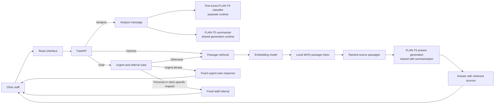

# Diabetes Care Support Assistant

**Course:** AIMLCZG549 - API-Driven Cloud-Native Solutions
**Assignment:** Assignment II
**Group:** 49
**Institution:** BITS Pilani, Work Integrated Learning Programmes
**Source repository:** [GitHub](https://github.com/sanjaykumarpushadapu/Assignment-APIDrivenCloudNativeSolutions-AIMLCZG549)

This report presents the design, implementation, and evaluation of an interactive diabetes-care support application. It addresses the four assessed areas in Assignment II: API-based AI application, fine-tuning, retrieval-augmented generation, and situated learning.

## Team Contribution and Work Allocation

Each member contributed 25% of the group work. The qualitative contributions below are organised around the four assessed parts in the assignment brief; the percentage records the group’s agreed equal share of the overall work.

| Sl. No. | BITS ID | Name | Contribution of team member  | Percentage Contribution (Out of 100) |
|---:|---|---|---|---:|
| 1 | 2025ae05391 | Bhuvnesh Mishra | **Part I – API-Based AI Application:** built the FastAPI and React application and connected classification, summarisation, and question answering in the staff workflow. | 25% |
| 2 | 2025ae05828 | Chezrla Raga Suma | **Part II – Fine-Tuning:** prepared and reviewed classification examples and labels, fine-tuned the FLAN-T5 classifier, and evaluated the base and tuned checkpoints. | 25% |
| 3 | 2025ae05425 | Sathish Krishnan V | **Part III – RAG:** selected and checked the WHO source, prepared the local knowledge passages, and implemented retrieval for question answering. | 25% |
| 4 | 2025ae05898 | Pushadapu Sanjay Kumar | **Part IV – Situated Learning:** defined the diabetes clinic support-desk workflow, selected representative synthetic cases, and analysed the evaluation against workplace needs. | 25% |
| **Total** |  |  |  | **100%** |

## Project and Platform Details

**Selected application category: Natural Language Processing (NLP).** The domain is healthcare support for a diabetes-clinic desk. The React and TypeScript interface with a FastAPI backend connects three NLP tasks: classify incoming support messages, prepare handoff summaries, and answer general diabetes questions from a curated World Health Organization (WHO) FAQ. Classification and summarisation use synthetic support messages; knowledge answers include the retrieved WHO passages.

| Task | Input and output | Model used by the application |
|---|---|---|
| Request classification | A support message is assigned one primary clinic-support category | Fine-tuned `google/flan-t5-base` checkpoint, `clinic-support` |
| Message summarisation | A support message is condensed into a staff handoff summary | Pinned `google/flan-t5-base` |
| Retrieval-augmented question answering | A question is answered from retrieved WHO passages, with the passages returned as sources | `google/flan-t5-base` answer model and `sentence-transformers/all-MiniLM-L6-v2` retriever |

The base FLAN-T5 revision is `7bcac572ce56db69c1ea7c8af255c5d7c9672fc2`. Classification uses a separate runtime; summarisation and answer generation share one FLAN-T5 runtime. Retrieval uses the separately configured embedding model. The API exposes `/health`, `/metadata`, `/analyze`, `/retrieve`, and `/chat`.

## Architecture Overview

The React and TypeScript interface sends support messages and questions to FastAPI. The diagram shows how the three tasks connect to the local models and WHO passages. The classifier has a separate runtime; summarisation and answer generation share a FLAN-T5 runtime. Chat routing can return a staff referral or an urgent-care response before generation.

## I. API-Based AI Application

### Domain and workflow

This NLP application supports a fictional diabetes-clinic support desk. In this workflow, staff read incoming messages, route requests, prepare handoffs, and consult education material when responding to general questions. Staff review the assistant's outputs before using them.

For example, one message may request an appointment change and help finding an education leaflet. The classifier selects the primary queue; the summary preserves the relevant requests for a staff handoff. A separate question about general diabetes information can be submitted to the knowledge assistant, which displays its answer and source passages.

### Application and API

The React interface collects support messages and knowledge questions. FastAPI validates requests and calls the configured model and retrieval components. `POST /analyze` returns a classification and summary; `POST /retrieve` returns ranked source passages; and `POST /chat` returns a generated answer, staff referral, or urgent-care response. `/metadata` reports component readiness and model or index versions.

The classifier uses the Hugging Face Transformers sequence-to-sequence interface. The application loads the tokenizer and model from the configured Hub model or local checkpoint. Classification uses a fixed task instruction and returns the generated label only when it matches one of the five supported categories: appointment support, education resource request, portal technical support, records/insurance administration, or clinical staff referral.

### API demonstration

The Swagger UI request below demonstrates `POST /analyze` with a synthetic rescheduling request. The React screenshot shows the category and handoff-summary field in the interactive application.

**Figure 1. Swagger request and response for `POST /analyze`.**

**Figure 2. Live support-message analysis in the interactive application.**

## II. Fine-Tuning

### Dataset and method

The classifier uses five support categories. The dataset contains 280 synthetic training messages, 60 validation messages, and 60 held-out test messages, with 56 training and 12 validation/test examples per category. The messages are AI-drafted and reviewed for the classification task. Scenario-family identifiers were used when preparing the partitions, and the exact-duplicate review found no repeated messages across the partitions.

The classifier received full fine-tuning from the pinned `google/flan-t5-base` checkpoint. AdamW updated the model parameters for one epoch, using batch size 1, gradient accumulation of 8, learning rate `5e-5`, and seed 42. The run completed 35 optimizer steps. The selected checkpoint was saved locally and used by the application.

### Validation and held-out results

The fine-tuned checkpoint achieved 98.33% accuracy and 98.33% macro-F1 on the 60-example validation set. The original model scored 71.67% accuracy and 71.81% macro-F1 on the same validation set. The validation set was used during model development, so these figures are validation results.

The base and fine-tuned models were then evaluated on the same 60-example held-out test set, with the same application prompt and greedy decoding. The test set was not used for training or model selection.

| Measure | Base model | Fine-tuned classifier |
|---|---:|---:|
| Accuracy | 86.67% (52/60) | 95.00% (57/60) |
| Macro precision | 95.00% | 95.39% |
| Macro recall | 86.67% | 95.00% |
| Macro-F1 | 88.74% | 94.74% |
| Invalid category outputs | 4/60 | 0/60 |

The examples and test set are synthetic; these scores summarise classification on the 60-message set.

**Figure 3. Fine-tuning method and held-out classifier results.**

### Summary quality check

The configured base summariser was evaluated on 20 reviewed synthetic message/summary cases with essential-fact checklists. Mean ROUGE-L F1 was 0.3912. All 20 outputs were supported by their input messages, and 10 of 20 retained every checklist fact.

## III. Retrieval-Augmented Generation

### Source and retrieval

The indexed corpus is prepared from one public source: the WHO page *Diabetes: Questions and Answers* (https://www.who.int/news-room/questions-and-answers/item/diabetes), dated 1 September 2026 in the local source manifest. The corpus contains eight curated passages covering diabetes basics, common symptoms, prevention, and high-level education and self-management support. Each passage carries its source title, section, URL, and chunk ID.

The retriever uses `sentence-transformers/all-MiniLM-L6-v2`, pinned to revision `1110a243fdf4706b3f48f1d95db1a4f5529b4d41`, and returns the three highest-ranked passages. The answer model receives the question and retrieved passages. `/chat` includes the retrieved passages with a generated answer; personal-care and clinic-specific requests receive a fixed staff referral, while selected urgent phrases receive a separate fixed urgent-care response.

### API demonstration

Swagger UI confirms that `/retrieve` returns ranked WHO passages and that `/chat` returns a staff referral for an individual medication question.

**Figure 4. Swagger response from `POST /retrieve` with ranked WHO passages.**

**Figure 5. Swagger response from `POST /chat` for a medication question.**

**Figure 6. General-information answer and retrieved source sections in the web interface.**

### Evaluation results

The RAG evaluation used 30 reviewed cases: 20 answerable from the indexed source and 10 expected to be referred to staff. Retrieval relevance, answer support, source citations, completeness, and expected answer/referral decisions were reviewed.

| Measure | Result |
|---|---:|
| Retrieval hit@3 on answerable cases | 20/20 (100%) |
| Expected answer/referral decisions matched | 23/30 (76.7%) |
| Expected staff referrals detected | 4/10 (40%) |
| Answerable questions incorrectly abstained | 1/20 (5%) |
| Answerable cases producing an answer judged supported by its source | 18/20 (90%) |
| Answerable cases with a correct source citation | 18/20 (90%) |
| Answerable cases with a correct and complete response | 16/20 (80%) |

The results show that retrieval returned relevant passages for all 20 answerable questions. Human review found 18 supported answers and 16 answers that were both correct and complete. Expected answer/referral decisions matched in 23 of 30 cases. These figures describe the evaluated RAG baseline.

## IV. Situated Learning - Workplace Application

### Anchor - Identify a workplace problem

The workplace analogue is a diabetes clinic support desk. Staff receive messages about appointments, education resources, the patient portal, records, and clinical questions. In the scenario, staff classify each request, prepare a handoff, and consult education material for general questions. The application supports these tasks with message classification, handoff summaries, and source-backed answers. Evaluation uses synthetic messages and public education material.

### Apply - Adapt the AI solution

The support-message interface accepts a message and displays its primary category and handoff-summary field. In the representative appointment case, the system classified the request as `appointment_support`. The summary evaluation is reported in Part II. The knowledge assistant accepts a question, displays an answer, and lists retrieved WHO passages.

For a general symptoms question, `/chat` returned an answer based on WHO01-003, “Common symptoms.” Figure 6 in Part III shows the answer and retrieved source sections. For “Should I change my diabetes medication?”, the interface displayed the fixed staff-referral response and no sources, shown in Figure 7. Together, these cases demonstrate classification, summarisation, source-grounded question answering, and referral in the staff workflow.

For selected urgent phrases, `/chat` returns the fixed urgent-care response before retrieval, as shown by the tested example “My father is unconscious, what is the next step?”.

**Figure 7. Medication question referred to clinic staff in the web interface.**

### Analyse - Evaluate workplace relevance

The three task evaluations show complementary workplace value: classification routes support requests, summaries prepare staff handoffs, and retrieval supplies passages for general-information answers. The test results provide separate measures for category prediction, fact retention, retrieval relevance, answer support, and referral decisions.

### Reflect - Project constraints and improvement

The evaluation used synthetic support messages and public WHO material, protecting personal information in the project dataset. A real staff workflow should apply role-based access, secure handling, and defined retention for message data, while meeting the regulatory requirements relevant to the organisation and its location. The application uses local model checkpoints and a local passage index, so deployment infrastructure must provide storage and suitable compute for inference. Its API provides integration points for approved clinic workflows and existing systems.

The priority improvement is independent, expert-led evaluation on a larger set of representative cases before wider use. This is the highest priority because the current results use small synthetic datasets; expert review can assess summary fact preservation, source support, and referral decisions in realistic staff scenarios.

## Conclusion

The project demonstrates a complete NLP application that combines a fully fine-tuned support classifier, FLAN-T5 handoff summarisation, and a WHO-grounded chatbot in a React/FastAPI workflow. On the held-out synthetic classifier set, fine-tuning achieved 95.00% accuracy and 94.74% macro-F1, compared with 86.67% and 88.74% for the base model. Summary review found 20/20 outputs supported by their input, with all essential facts retained in 10/20. RAG achieved 20/20 retrieval hit@3; human review judged 18/20 answerable responses supported and 16/20 correct and complete. Screenshots and evaluation records document the application and its workplace scenarios. The work demonstrates learning to connect NLP, model fine-tuning, retrieval, and task-specific evaluation in an API-based staff-support workflow.

## Demonstration Video

**Demonstration video:** Google Drive link to be added after the required project demonstration is uploaded.

## References

1. Google Research / Hugging Face, [FLAN-T5 Base model card](https://huggingface.co/google/flan-t5-base).
2. Hugging Face, [T5 model documentation](https://huggingface.co/docs/transformers/en/model_doc/t5).
3. Sentence Transformers, [all-MiniLM-L6-v2 model card](https://huggingface.co/sentence-transformers/all-MiniLM-L6-v2).
4. World Health Organization, [Diabetes: Questions and Answers](https://www.who.int/news-room/questions-and-answers/item/diabetes), accessed 31 October 2026.
